## 1.	Instalación de phpadmin
<figure markdown="span">
  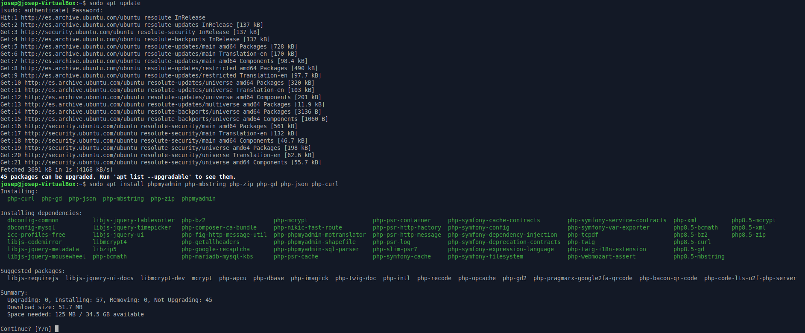{ width="90%" }
  <figcaption>Fig.1: Instalación phpmyadmin</figcaption>
</figure>

--- 

<figure markdown="span">
  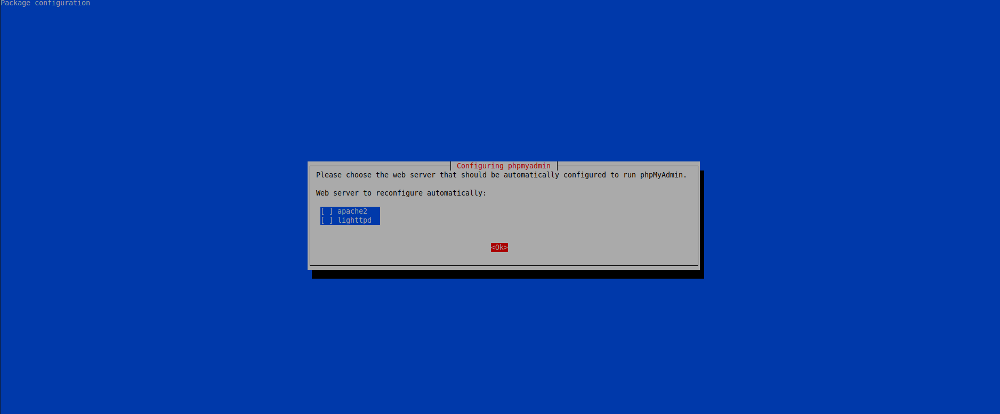{ width="90%" }
  <figcaption>Fig.1.1: Selección de servidor web</figcaption>
</figure>

!!! warning "Cuidado"
    No seleccionamos ninguno ya que lo queremos en nginx y no en ninguna de estas 2, lo configuraremos manualmente en el fichero de configuración de nginx.


# 2.	Insertamos el código para que pueda servir mediante nginx.

Copiamos el fichero default y le pondremos **phpadmin**:

<figure markdown="span">
  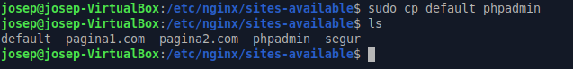{ width="90%" }
  <figcaption>Fig.2: fichero default</figcaption>
</figure>


Procederé a abrir phpadmin y le pondremos este código
 
<figure markdown="span">
  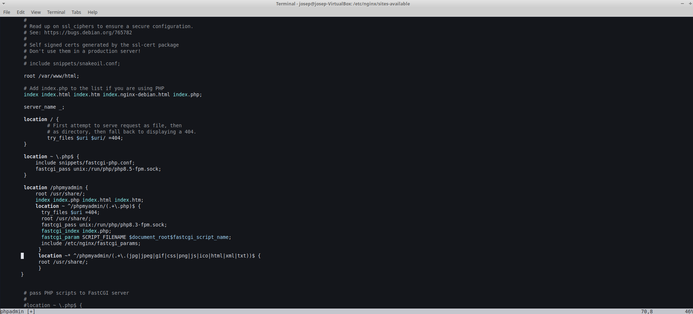{ width="90%" }
  <figcaption>Fig.2-1: fichero phpadmin</figcaption>
</figure>

En ``location`` y en la parte de root se debe poner la ruta donde esta phpmyadmin para que funcione, sino, no funcionara.

# 3.	Activamos el sitio con ln -s

```bash
sudo ln -s /etc/nginx/sites-available/phpadmin /etc/nginx/sites-enabled/phpadmin
```


<figure markdown="span">
  { width="90%" }
  <figcaption>Fig.3: Sitio acabado</figcaption>
</figure>


# 4.	Comprobamos la configuración y reiniciamos servicio

<figure markdown="span">
  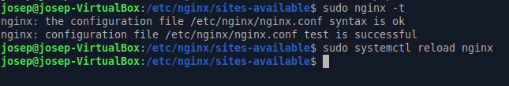{ width="90%" }
  <figcaption>Fig.4: Comprobaciones</figcaption>
</figure>


# 5.	Editamos el fichero hosts

<figure markdown="span">
  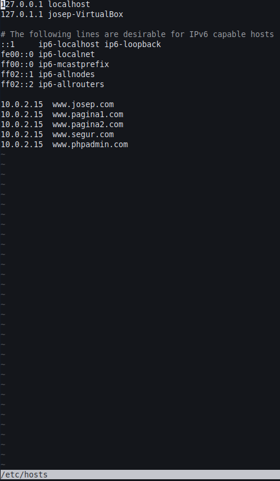{ width="90%" }
  <figcaption>Fig.5: Dominio asignado para el fichero phpadmin</figcaption>
</figure>


# 6.	Comprobación

<figure markdown="span">
  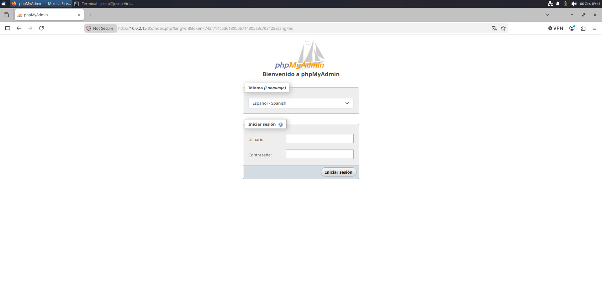{ width="90%" }
  <figcaption>Fig.6: Inicio de sesión de phpmyadmin</figcaption>
</figure>


# 7.	Permetre l’Accés per Contrasenya del root de MySQL
 
<figure markdown="span">
  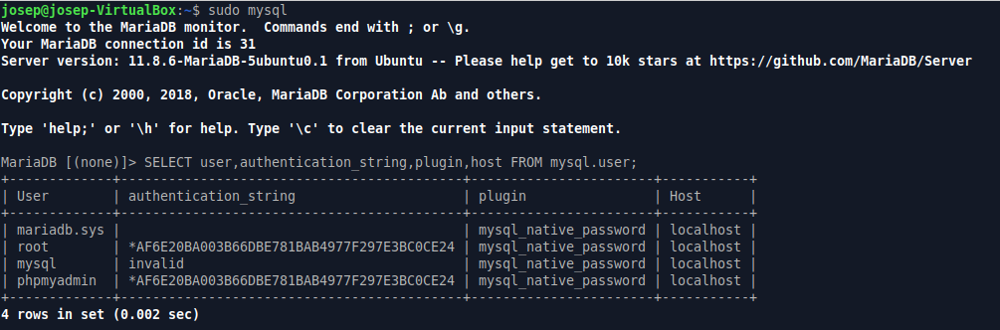{ width="90%" }
  <figcaption>Fig.7: Entramos a MySQL y comprobamos los usuarios que hay</figcaption>
</figure>

<figure markdown="span">
  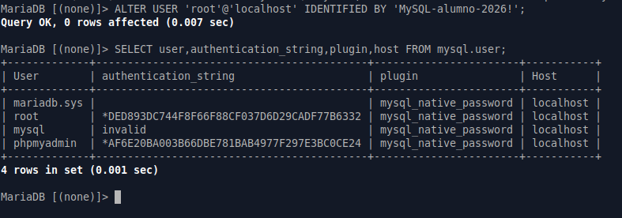{ width="90%" }
  <figcaption>Fig.7: Se pudo cambiar correctamente la contraseña</figcaption>
</figure>
 

!!! warning "Cuidado"
    El comando que hay en aules para cambiar la contraseña para MariaDB no es compatible,
    seria este comando: 
    
    ALTER USER 'root'@'localhost' IDENTIFIED BY 'MySQL-alumno-2026!


# 8.	Configuració de l’Accés per Contrasenya per a un Usuari Dedicat de MySQL

<figure markdown="span">
  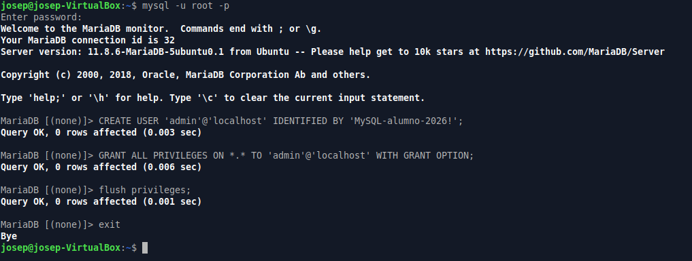{ width="90%" }
  <figcaption>Fig.8: Usuario creado</figcaption>
</figure>
 

# 9.	Comprobamos

<figure markdown="span">
  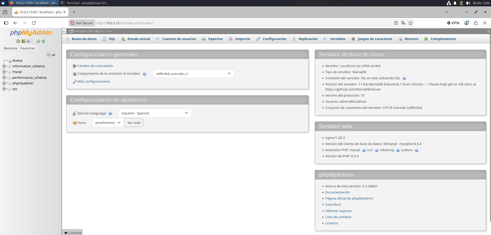{ width="90%" }
  <figcaption>Fig.9: Entramos con credenciales del usuario admin</figcaption>
</figure>

# 10.	Assegura la Instància de phpMyAdmin
 
<figure markdown="span">
  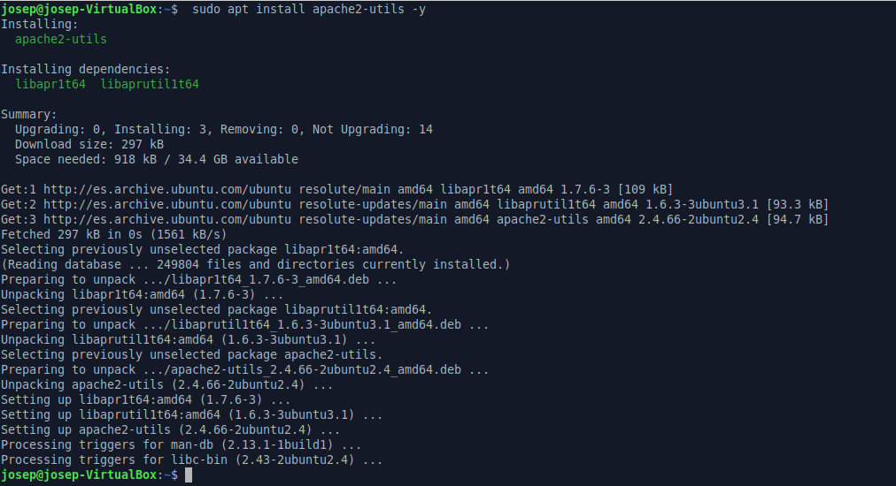{ width="90%" }
  <figcaption>Fig.10: Apache instalado</figcaption>
</figure>

<figure markdown="span">
  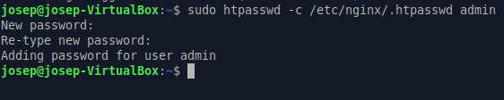{ width="90%" }
  <figcaption>Fig.10-1: Ejecutamos htpasswd</figcaption>
</figure>

<figure markdown="span">
  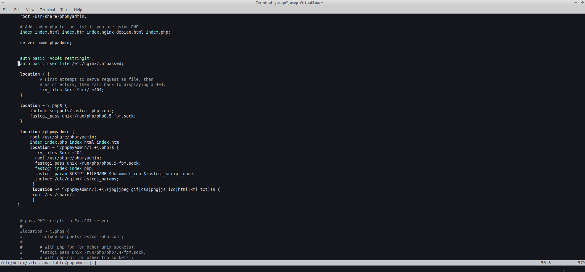{ width="90%" }
  <figcaption>Fig.10-2: Añadimos este contenido al fichero phpadmin dentro de nginx</figcaption>
</figure>
 
1. auth_basic "Accés restringit";
2. auth_basic_user_file /etc/nginx/.htpasswd;

<figure markdown="span">
  { width="90%" }
  <figcaption>Fig.10-3: Recargamos el servidor nginx para que aplique la configuración y protegemos los ficheros correspondientes.</figcaption>
</figure>

Recargamos el servidor nginx para que aplique la configuración y protegemos los ficheros correspondientes.

# 11.	Creamos una carpeta y añadimos este contenido

<figure markdown="span">
  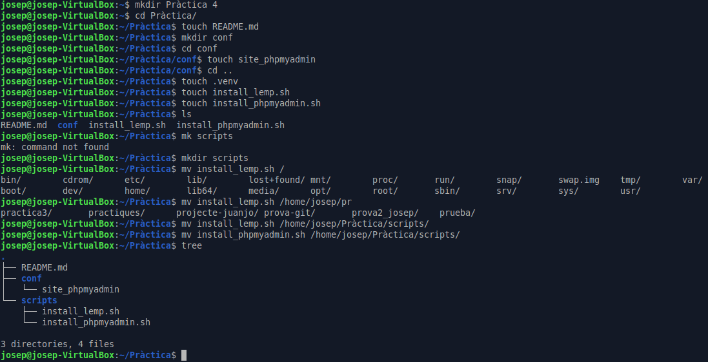{ width="90%" }
  <figcaption>Fig.11: Contenido añadido.</figcaption>
</figure>

# 12. Subimos todo el contido a GitHub pages

<figure markdown="span">
  { width="90%" }
  <figcaption>Fig.12: Ficheros subidos.</figcaption>
</figure>


# 13. Si quiere ver más información de la practica, por favor, descargatelo de por aqui

<a href="/Pràctica 4 phpmyadmin - Josep Calvo.pdf" download class="md-button md-button--primary">
  <span class="twemoji">
    <svg xmlns="http://www.w3.org/2000/svg" viewBox="0 0 24 24">
      <path fill="currentColor" d="M5 20h14v-2H5v2zm7-18v10l4-4 1.4 1.4L12 17l-5.4-5.6L8 10l3 2V2h1z"/>
    </svg>
  </span>
  Descargar práctica en PDF
</a>
